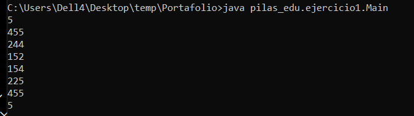
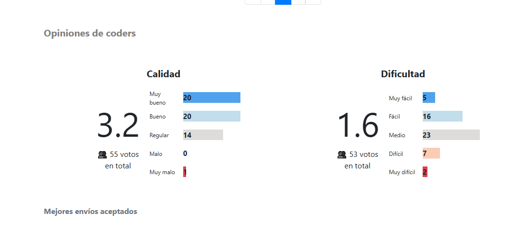
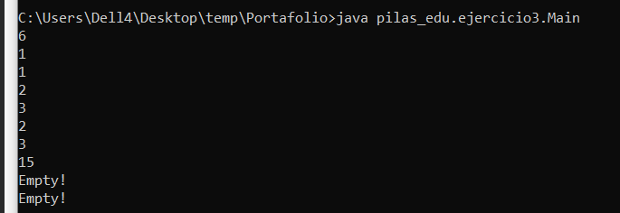
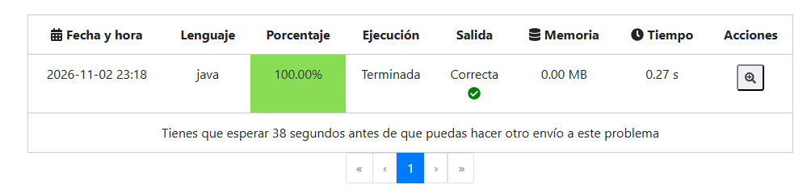

# Ejercicios de tare de listas 
primer ejercicio 
Descripción breve del problema con tus propias palabras.
Se realiza un programa para un estacionamiento usando una pila y da como salida la cantidad de autos que debes de sacar primero antes de poder sacar el requerido
Explicación del algoritmo (o diagrama de nodos y punteros).
Primero se define la cantidad de auots a meter y lo tomamos como el tope, despues se ingresan las placas de estos autos y posteriormente se le dice al progama cual auto quieren sacar por medio de su placa y da como regreso la cantidad de auots a sacar para sacar ese auto siguiento el LIFO
##captura de ejecucion

## captura de opinion de omega

segundo ejercicio: EasyStack
Descripción breve del problema con tus propias palabras.
Se realiza un programa donde tenemos una pila vacía y nos dan varias instrucciones para meter números, sacar el que está hasta arriba o revisar cuál es el número que está en el tope.

Explicación del algoritmo.
Primero leemos la cantidad de instrucciones y las vamos revisando una por una. Cuando la instrucción es 1, leemos otro número y lo metemos a la pila. Cuando es 2, sacamos el último número que metimos, pero si la pila está vacía no hacemos nada. Cuando es 3, mostramos el número que está hasta arriba y si no hay ninguno imprimimos "Empty!".

En `Main.java` se leen las instrucciones y se muestran las respuestas. En `Pila.java` guardamos los números en un arreglo y usamos la variable `tope` para saber cuántos hay. Al meter un número avanzamos el tope y al sacar uno lo hacemos retroceder. La pila sigue el orden LIFO, el último número que entra es el primero que sale.

El método `siguienteInt` nos ayuda a leer los números de forma rápida. En este ejercicio usamos el arreglo para guardar los datos, por eso `Nodo.java` no se utiliza.
##captura de la ejecucion

##captura de el codigo en omega

